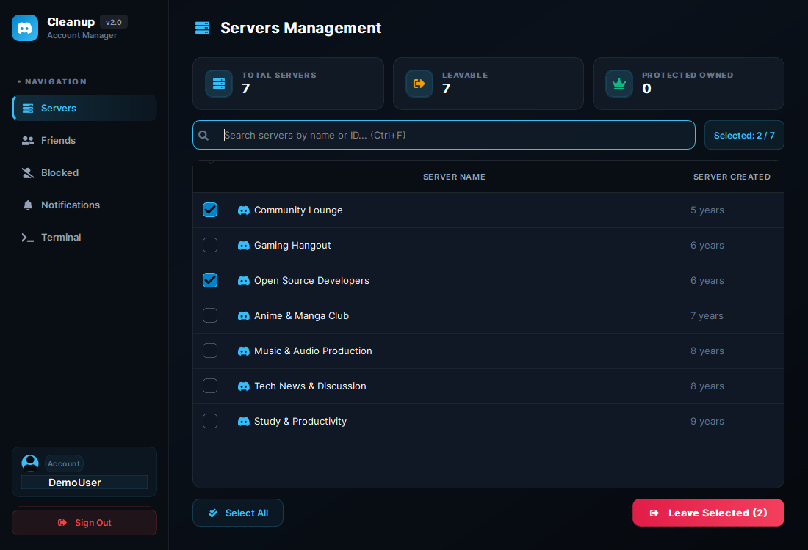
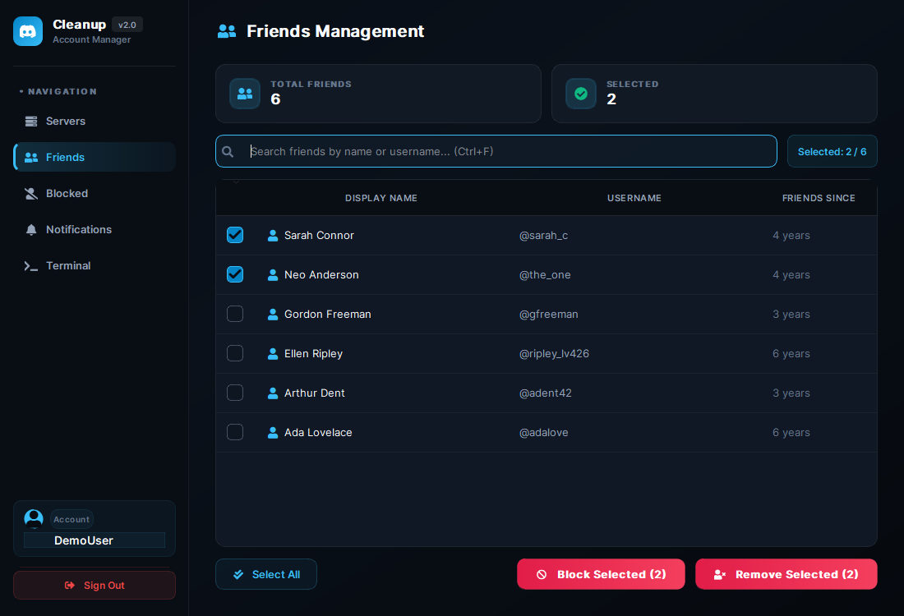
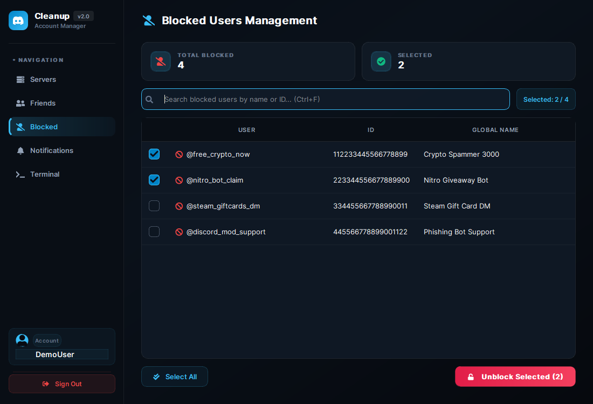
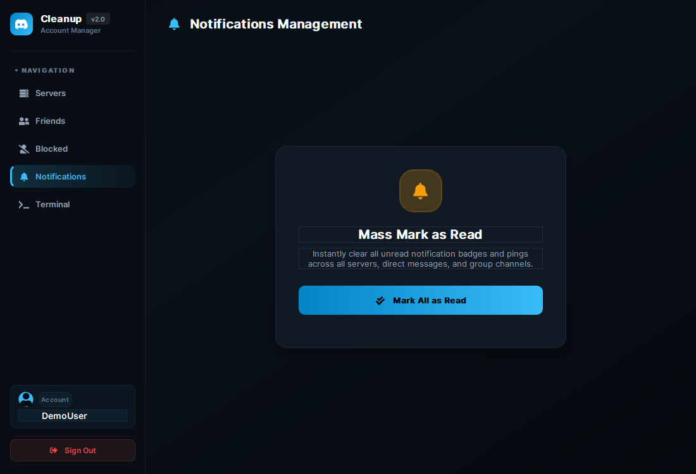

# Discord Mass Account Cleanup Tool

A robust, asynchronous desktop application and command-line utility built with Python and PyQt5 for inspecting and bulk-managing Discord servers, relationships, and notification read-states, and checking short username availability.

Designed with a strict multi-layered architecture, coordinated rate-limiting backoff, cooperative cancellation, adversarial credential redaction, and deterministic offline unit testing.



---

## Technical Highlights & Engineering Narrative

- **Asynchronous GUI Architecture**: Built with PyQt5 and decoupled background `QThread` workers communicating strictly via typed Qt signals, ensuring the main GUI event loop remains fluid at 60 FPS during long-running batch operations.
- **Shared Request Coordination & Rate Limiting**: Centralized `RequestCoordinator` enforces polite cross-worker request pacing and dynamically honors Discord `Retry-After` headers across concurrent operations without bursting upstream limits.
- **Adversarial Credential Security**: Multi-pattern token sanitization regex engine scrubs user tokens, MFA secrets, and Authorization headers across CLI prompts, stream interceptors, crash logs, and exported diagnostic files. Tokens are stored encrypted via the OS Keyring (`keyring`) and scrubbed from worker memory immediately upon task completion.
- **Fail-Safe Destructive Action Workflows**: Two-step verification workflows require explicit user selection, summary previews (displaying target counts and names), and confirmation dialogs before executing irreversible actions (such as leaving servers or deleting friendships).
- **Clean Transport Abstraction**: Fully modular HTTP transport layer built on standard protocols without browser fingerprinting, evasion tricks, or brittle global mocking hooks.
- **Comprehensive Offline Test Suite**: 150+ unit and component tests covering domain models, rate limiting, network transports, resumable username scans, worker lifecycle states, and PyQt UI pages using mocked fixtures with zero live Discord API calls.
- **Automated CI/CD Pipeline**: GitHub Actions workflow running automated lint checks (`Ruff`), static type checking (`Mypy`), cross-platform matrix testing on Ubuntu & Windows, and automated Windows executable releases with SHA256 checksums.

---

## Screenshots

| Servers Management | Friends Management | Blocked Users | Notification Badges |
|:---:|:---:|:---:|:---:|
|  |  |  |  |

---

## Architecture

```
                                  +-----------------------+
                                  |   GUI (PyQt5) / CLI   |
                                  +-----------+-----------+
                                              |
                     +------------------------+------------------------+
                     |                                                 |
         +-----------v-----------+                         +-----------v-----------+
         |  Background QThreads  |                         |  CLI Workflow Runner  |
         |  (Cancellable Worker) |                         |  (Preview & Confirm)  |
         +-----------+-----------+                         +-----------+-----------+
                     |                                                 |
                     +------------------------+------------------------+
                                              |
                                  +-----------v-----------+
                                  |   DiscordApiClient    |
                                  +-----------+-----------+
                                              |
                     +------------------------+------------------------+
                     |                                                 |
         +-----------v-----------+                         +-----------v-----------+
         |  RequestCoordinator   |                         |     HttpTransport     |
         |  (Backoff & Retries)  |                         | (Timeout & Parse JSON)|
         +-----------------------+                         +-----------+-----------+
                                                                       |
                                                           +-----------v-----------+
                                                           |   Discord REST / WS   |
                                                           +-----------------------+
```

---

## Platform Compliance & Policy Boundary

> [!IMPORTANT]
> **Platform Policy Notice**:
> This tool automates operations through standard user-account HTTP endpoints. User-token automation is not officially supported by Discord and may violate Discord's Terms of Service.
>
> - **No Circumvention**: This application does **not** employ browser fingerprint evasion, CAPTCHA bypasses, anti-bot circumvention, or hidden automation stealth.
> - **Honest Error Handling**: Authentication and access failures are reported honestly. HTTP `429` responses honor Discord's retry deadline; public checks save that deadline across restarts. Unverified responses are never reported as available names.
> - **Intended Use**: For personal account auditing, server pruning, and relationship cleanup on accounts you control.

---

## Installation & Running Locally

### Prerequisites
- Python 3.10, 3.11, 3.12, 3.13, or 3.14
- Operating System: Windows, Linux, or macOS

### 1. Clone & Setup Environment

```bash
git clone https://github.com/AnasBabari/Discord-Mass-Account-Cleanup-Tool.git
cd Discord-Mass-Account-Cleanup-Tool

# Create and activate virtual environment
python -m venv venv
# Windows:
.\venv\Scripts\activate
# Linux/macOS:
source venv/bin/activate

# Install in editable mode with development dependencies
pip install -e ".[dev]"
```

### 2. Launch Application

**Launch Desktop Graphical Interface:**
```bash
python -m discord_cleanup
# or
discord-cleanup-gui
```

**Launch Interactive CLI Mode:**
```bash
python -m discord_cleanup --cli
# or
discord-cleanup
```

---

## Username Availability Checker

**No Discord login is needed.** On the desktop login screen, choose **Username Checker — no login required**. In the CLI, launch the public checker directly:

```bash
# Interactive menu:
python -m discord_cleanup --usernames
discord-cleanup --usernames

# Non-interactive CLI options & help:
python -m discord_cleanup --usernames --help
python -m discord_cleanup --usernames --check "cat,dog,owl" --export results.csv
python -m discord_cleanup --usernames --lengths 3 --strategy randomized --charset letters --pattern CVC --seed 42 --max-network-requests 25
python -m discord_cleanup --usernames --input-file candidates.txt --max-definitive-checks 10 --export batch.csv
python -m discord_cleanup --usernames --diagnostics
```

The normal CLI token prompt also accepts `u` to open public checks. Signed-in users can select **Usernames** in the sidebar or **[5] Check Usernames (Public)** in the CLI. Existing account-based scans remain available through the desktop's **Signed-in account** source and CLI option **[6]**; public mode never silently falls back to account-based checks or reads saved credentials.

### Candidate Strategies & Search Modes
- **Exhaustive search (`generator_version = 1`):** Check three-character names (`54,797` valid candidates), four-character names (`2,080,880` valid candidates), or both (`2,135,677` total, with three-character names first). Candidates use lowercase `a-z`, digits `0-9`, `_`, and `.`; consecutive periods (`..`) are excluded. Names are decoded incrementally in $O(1)$ memory rather than building lists in RAM.
- **Seeded randomized & filtered search (`generator_version = 2`):** Uses a deterministic cycle-walking Feistel permutation over the candidate domain so scans traverse candidates in pseudo-random order **without replacement** in $O(1)$ memory and resume accurately from `(seed, cursor)`. Supports character-set filters (`all`, `letters`, `alphanumeric`, `no_punctuation`) and pattern filters (`any`, `pronounceable`, `starts_with_letter`, `no_edge_punctuation`, `palindrome`, or custom templates such as `CVC`, `LLL,LLLL`, `LL#,LL##`). Exact candidate counts are computed in $O(\text{length} \times |\Sigma|)$ via combinatorial/DP counting and cached across seed/strategy changes so UI controls never iterate through millions of indices on the main thread.
- **Priority heuristic ordering:** Orders custom or filtered candidates by user utility (3-character names before 4-character names, pronounceable CVC/VCV and letter-only handles before digits and punctuation). This is strictly a candidate-ordering heuristic to test higher-utility handles first, not a prediction of server availability.
- **Custom list & Watchlist:** Paste names separated by spaces, commas, or newlines, or save priority candidates to the persistent **Watchlist**. Leading `@` signs and uppercase letters are normalized; duplicates are removed; syntactically invalid names are rejected locally without network calls. Watchlist runs prioritize unobserved or stale candidates first.
- **Candidate preview:** Both the desktop UI and CLI (`--preview`) preview total matching candidates, sample ordering, and local validation counts before dispatching any network requests.

### Observation Cache, Time-Based Freshness & Deduplication
- **Shared observation cache with asymmetric TTLs:** Definitive observations (`available`, `unavailable`, and local `invalid`) are stored in `observation_cache` keyed by `(username, provider, scope)`. Because available names can be claimed quickly while taken names rarely free up, `available` observations use a shorter freshness window (default `15` minutes) than `unavailable` observations (default `24` hours). Operational/network errors are never cached.
- **Separation of historical observation, origin & time-based freshness:** Every result preserves its original `checked_at` UTC timestamp, sub-second `observed_epoch` / `expires_epoch`, original `origin` (`network`, `cache`, `local`, `stale_cache`), and `expires_at` deadline. Reading a result never refreshes `checked_at` or extends `expires_at`. Once the current time passes `expires_at`, both direct network results and cached results transition automatically to `available (historical)` / `unavailable (historical)`—including live in-place updates in the open desktop `UsernamesPage` table, status summary, **Available (fresh only)** filter, clipboard copy actions, CSV exports (`provenance` and `freshness` columns), CLI output, and watchlist selection. Use **Fresh Recheck** in the desktop UI or `--force-recheck` / `--no-cache` in the CLI to force a live network check; fresh rechecks enforce the contract `effective_observed_epoch() >= recheck_requested_epoch` across cache reads, in-process sharing, and cross-process candidate-lock handoffs.
- **In-flight deduplication, independent deadlines & atomic budget attribution:** Concurrent checks for the same `(username, provider, scope)` across threads or processes share a single in-flight request via per-consumer waiter slots (`_InFlightEntry`) and cross-process `candidate_inflight_lock`. Shared work is governed by the union of active consumers (`effective_deadline_mono()`) rather than the original leader's deadline alone: if one consumer cancels or hits its duration budget while another consumer remains active, the expiring consumer returns promptly with saved progress while the remaining consumer completes the check. Network request eligibility, reservation, rollback on pre-dispatch cancellation/expiry, and commit are executed atomically (`reserve_and_commit_attempt`), so if one consumer's `max_network_requests` budget is exhausted before a retry, ownership transfers cleanly to the next eligible consumer and provider-wide attempt totals match the sum of per-scan `network_checks`.

### Rate-Limit Scheduling, Budgets & Provider Health
- **Persistent multi-constraint scheduling:** Parses `Retry-After` (seconds and HTTP-date), JSON `retry_after`, `X-RateLimit-Limit`, `X-RateLimit-Remaining`, `X-RateLimit-Reset`, `X-RateLimit-Reset-After`, `X-RateLimit-Bucket`, `X-RateLimit-Scope`, and `X-RateLimit-Global`. Cooldown deadlines are persisted across restarts and shared across desktop and CLI processes using `usernames.sqlite3`. Route-bucket deadlines are scoped to their associated route while `global:{scope}` deadlines apply across the scope. Active server deadlines are never shortened, external deadline extensions sync into monotonic waits, and optional retry jitter is strictly positive-only.
- **Enforced request budgets & realistic ETA:** Configure optional per-run budgets (`max_network_requests`, `max_definitive_checks`, `max_duration_seconds`, `max_consecutive_failures`). `max_network_requests` is enforced at the exact HTTP transport attempt boundary (counting retries, `429` responses, `5xx` errors, and connection failures so a budget of `1` never dispatches a second HTTP attempt), while `max_duration_seconds` is enforced across cooldown waits, lock waits, and backoff sleeps. Diagnostics track both `network_requests_total` (all HTTP attempts) and `definitive_network_checks` (HTTP 200/400 definitive answers), and merge overlapping active intervals while excluding idle gaps between scans.
- **Enforced provider health circuit breaker:** Tracks `ready`, `waiting_cooldown`, `backing_off`, `paused_failures`, `blocked_challenge`, and `uninterpretable_response`, persisting `consecutive_failures` and `consecutive_rate_limits` across runs and processes. Open circuit states (`blocked_challenge`, `uninterpretable_response`, `paused_failures`) are enforced at the shared dispatch boundary so starting a new scan, resuming a failed scan, or running another process against the same database will not dispatch live network requests while local validation and fresh cache hits continue to work. Use **Reset Health** (`--reset-health`) to clear the circuit breaker while retaining any active server cooldown.

### Evidence Boundaries & Simulated Workload Metrics
- **Observed facts:** Discord has no documented public bulk username-availability API. The unauthenticated signup endpoint (`POST /api/v10/unique-username/username-attempt-unauthed`) accepts one JSON `{"username": ...}` payload per request, returns `{"taken": true|false}` on HTTP `200`, and enforces strict HTTP `429` cooldown windows (`retry_after`). The authenticated profile endpoint (`POST /api/v10/users/@me/pomelo-attempt`) requires an authenticated account token.
- **Inferences:** Reusing fresh observations across overlapping custom lists/watchlists, rejecting syntactically invalid names locally, deduplicating concurrent checks, and ordering candidates via seeded permutations or utility heuristics improve useful findings per unit of allowed network capacity without increasing server request rates.
- **Unknown server behavior:** Whether unauthenticated and authenticated endpoints share internal IP or ASN rate-limit buckets on Discord's backend cannot be verified without live multi-endpoint traffic tests against Discord's servers and is therefore treated as unknown; public and account scopes remain strictly isolated.
- **Simulated workload reduction:** In the deterministic two-scan overlapping workload (`6` candidates in Scan 1 including `2` locally invalid names, followed by `5` candidates in Scan 2 with `3` cached overlaps and `1` locally invalid name), live HTTP requests drop from `11` to `5` (**`54.5%` reduction vs. a naive checker** with no local validation or caching, and **`37.5%` reduction (`8` to `5`) vs. the previous implementation** that already rejected invalid syntax locally).

### Truthful Availability & Storage
Public mode uses Discord's undocumented signup availability endpoint (`/api/v10/unique-username/username-attempt-unauthed`) and sends no account token. It only labels a name available after HTTP 200 with an explicit Boolean `"taken": false`. Availability is an observation at the recorded time, not a reservation; claim a name manually in Discord. Uncertain responses are shown as **unverified** and never counted as available.

Progress, cached observations, watchlists, provider health, and bounded sanitized diagnostics are stored in `usernames.sqlite3` in the per-user application data directory:

| Platform | Default directory |
|:---|:---|
| Windows | `%LOCALAPPDATA%\DiscordMassCleanupTool` |
| macOS | `~/Library/Application Support/DiscordMassCleanupTool` |
| Linux | `${XDG_DATA_HOME:-~/.local/share}/DiscordMassCleanupTool` |

Existing databases upgrade automatically in place while preserving saved scans, cursors, timestamps, public/account separation, and active cooldowns.

---

## Development & Quality Assurance

### Run Unit Test Suite
```bash
python -m pytest tests/ -v --cov=src/discord_cleanup --cov-report=term-missing
```

### Run Static Analysis & Linting
```bash
python -m flake8 src tests --max-line-length=140
python -m mypy
```

### Build Windows Standalone Executable
```bash
pyinstaller discord_cleanup.spec
```
The compiled binary will be placed under `dist/Discord-Mass-Cleanup-Tool.exe`.

---

## Project Structure

```
├── pyproject.toml                     # Modern package metadata & tool configuration
├── discord_cleanup.spec               # PyInstaller standalone executable recipe
├── README.md                          # Project documentation & engineering overview
├── LICENSE                            # MIT License
├── .github/
│   └── workflows/
│       └── release.yml                # CI matrix testing & release deployment
├── src/
│   └── discord_cleanup/
│       ├── __init__.py                # Package root
│       ├── __main__.py                # CLI / GUI entrypoint dispatcher
│       ├── models/
│       │   └── domain.py              # Typed domain dataclasses (Guild, Relationship, User)
│       ├── security/
│       │   ├── token_sanitizer.py     # Adversarial regex token redactor
│       │   └── credentials.py         # OS Keyring secure token storage
│       ├── transport/
│       │   └── http_transport.py      # Clean HTTP transport abstraction
│       ├── api/
│       │   ├── exceptions.py          # Domain error hierarchy
│       │   ├── rate_limiter.py        # Cross-thread request coordinator & backoff
│       │   └── client.py              # Discord REST API client
│       ├── gateway/
│       │   └── notifications.py       # Gateway WebSocket notification reader
│       ├── logging/
│       │   └── logger.py              # Redacting logger and Qt signal handlers
│       ├── cli/
│       │   └── main.py                # Interactive CLI with preview & confirmation
│       ├── workers/                   # Background QThread workers
│       │   ├── base.py                # CancellableTokenWorker base
│       │   ├── login.py               # Token verification & avatar loader
│       │   ├── fetch.py               # Guild/friend/blocked fetchers
│       │   ├── batch.py               # Batch removal/leave/block workers
│       │   └── notifications.py       # Notification ack worker
│       └── ui/
│           ├── theme.py & theme.qss   # Design system tokens & stylesheet
│           ├── components.py          # Custom Qt components (GlassCard, StatCard, Toast)
│           ├── app.py                 # MainWindow & Qt application lifecycle
│           └── pages/                 # UI pages (Login, Servers, Friends, Blocked, Logs)
└── tests/                             # Offline mocked unit test suite
    ├── conftest.py                    # Pytest fixtures & offscreen Qt setup
    ├── test_token_security.py         # Adversarial token redactor tests
    ├── test_transport.py              # Transport & timeout tests
    ├── test_rate_limiter.py           # Rate limiting & cancellation tests
    ├── test_api_client.py             # REST API client tests
    ├── test_gateway.py                # WebSocket Gateway tests
    ├── test_domain_models.py          # Data model serialization tests
    ├── test_cli.py                    # CLI workflow & selection parser tests
    ├── test_workers.py                # Worker signal & cancellation tests
    ├── test_gui_lifecycle.py          # MainWindow lifecycle & worker leak tests
    ├── test_gui_components.py         # Qt component tests
    └── test_gui_pages.py              # Page interaction tests
```

---

## License

This project is licensed under the terms of the [MIT License](LICENSE).
